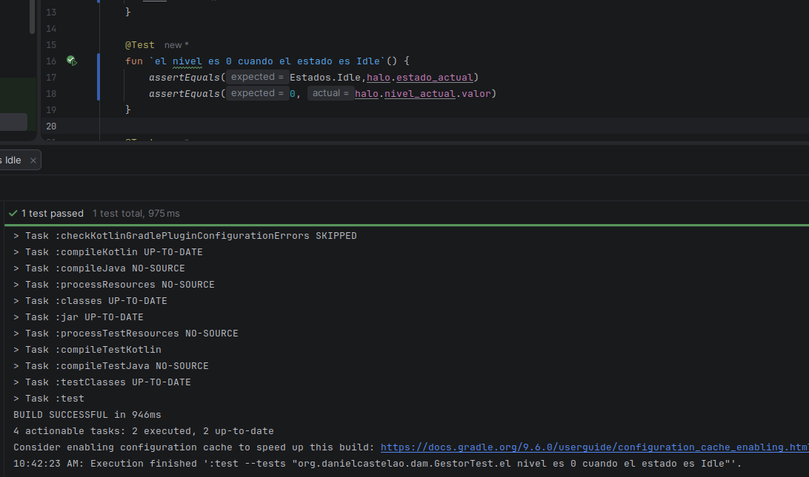
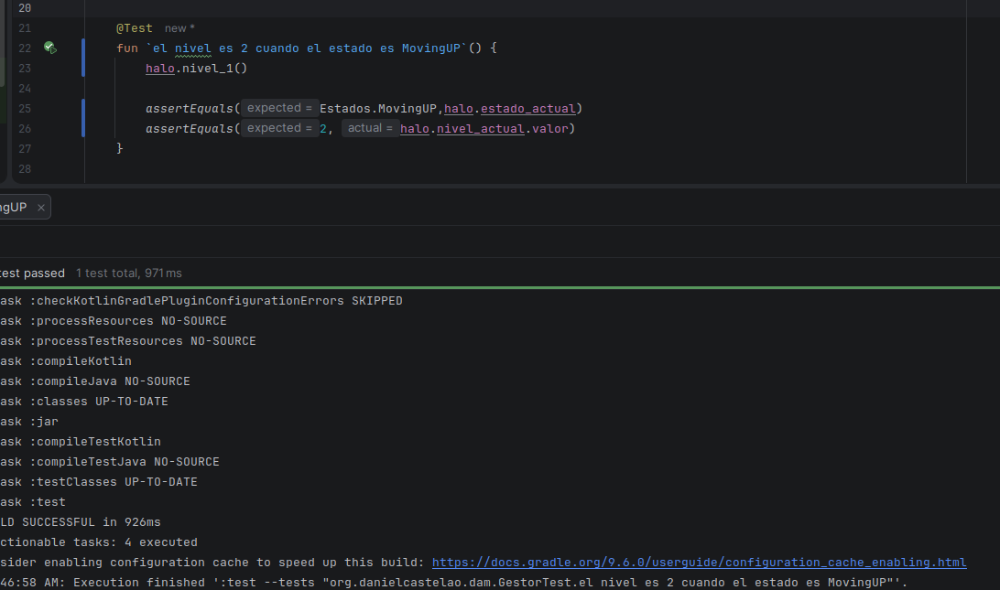
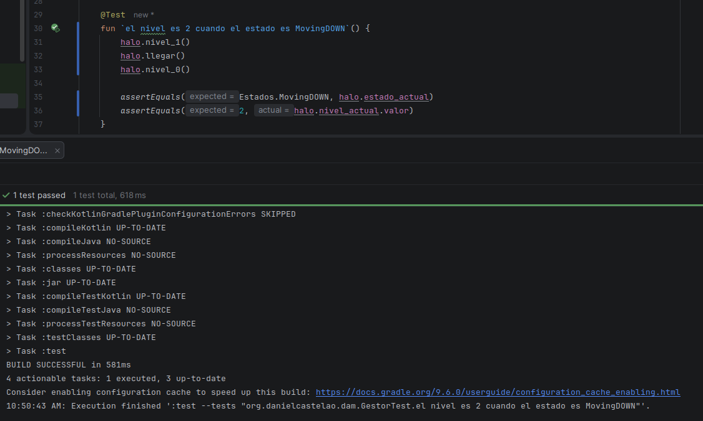
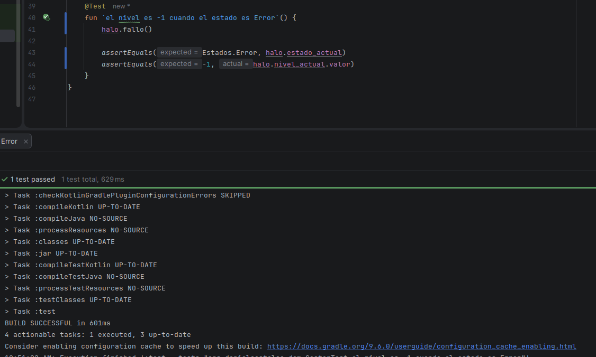

## Explicacion  y proceso estados Halo

- nombre  --> (String) Se encarga de describir como se encuentra la maquina
- enMovimiento --> (Boolean) Se encarga de avisar si el ascensor de encuentra en movimiento o parado

- Idle --> Estado inicial en que el comprobamos si esta en reposo el ascensor
- MovingUP --> Estado que indica que el ascensor esta subiendo
- MovingDOWN --> Estado que indica que el ascensor esta bajando
- Error --> Indica un error en el proceso
  

## TESTS

Test 1 - Comprueba el estado inicial, un `Halo` recién creado empieza en `Idle` y en la avenida por lo que `nivel_actual.valor` es 0

Test 2 - Pulsa `nivel_1()` desde avenida, la máquina pasa de `Idle` a `MovingUP` y mientras sube no está en ningún nivel así que `nivel_actual.valor` es 2

Test 3 - Primero sube (`nivel_1()` y `llegar()`) para quedar en la plaza y luego pulsa `nivel_0()`. La maquina pasa a `MovingDOWN` y `nivel_actual.valor` es 2 porque vuelve a moverse

Test 4 - Llama a `fallo()`. La maquina pasa a `Error` y `nivel_actual.valor` es -1 porque en ese estado no esta en ningun nivel y no se puede mover

